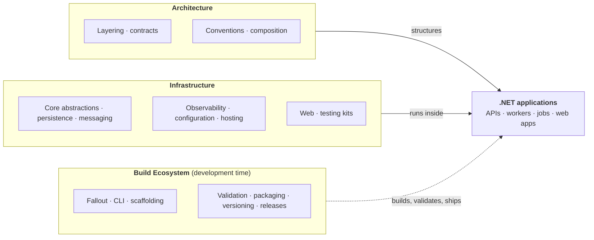
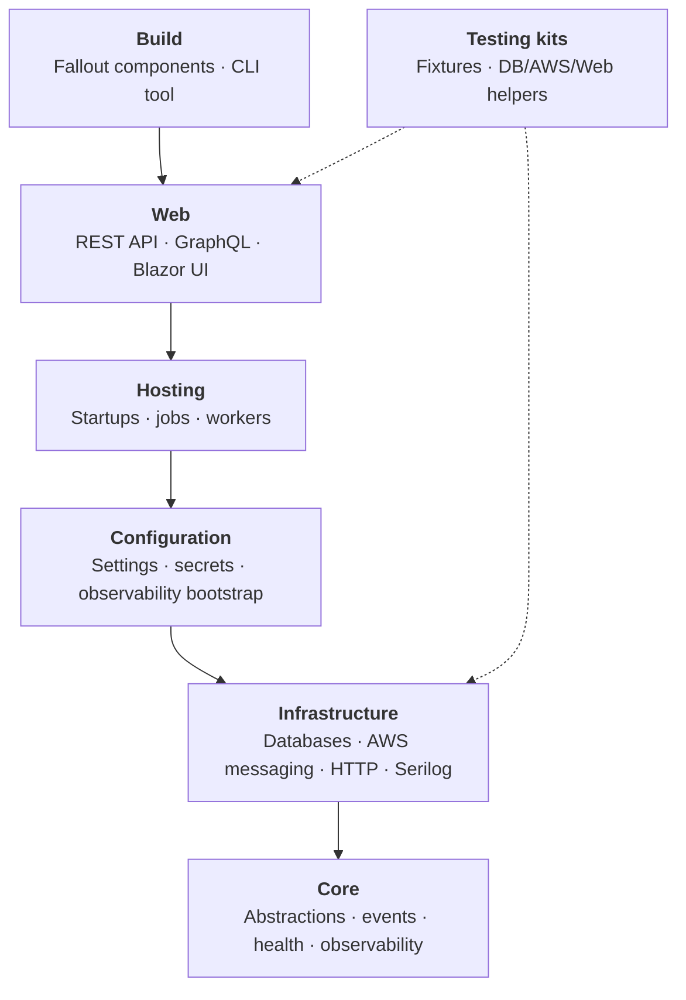

# Overview

## What is Anarchy I/O Toolkit?

The **Anarchy I/O Toolkit** is a **.NET developer platform**: an integrated ecosystem for building maintainable .NET applications (REST and GraphQL APIs, [Blazor](https://learn.microsoft.com/aspnet/core/blazor/) WebApps, [AWS Lambda](https://aws.amazon.com/lambda/) jobs and EC2 workers) through consistent architecture, reusable infrastructure and automated development workflows.

> **Provide the foundation. Never dictate the destination.** The toolkit ships plumbing, not a framework: your domain, your architecture decisions and your vendors stay yours, and no part of the platform requires adopting the rest.

## The three pillars

| Pillar | What it provides | Start with |
|---|---|---|
| **Architecture** | How applications are structured and how dependencies are governed: the layers `Core < Infrastructure < Configuration < Hosting < Web < Build`, DI modules as the unit of composition, and conventions for async code, exceptions, enums, endpoints and tests. | [Layered Architecture](guides/architecture.md), [Guides](guides/README.md) |
| **Infrastructure** | Reusable application capabilities, published as independent NuGet packages: core abstractions, persistence ([PostgreSQL](https://www.postgresql.org/), Oracle, MySQL), messaging (AWS SNS/SQS), observability, configuration and secrets, hosting for jobs and workers, REST/GraphQL/Blazor pipelines, and testing kits. | [Package Catalog](packages/README.md) |
| **Build Ecosystem** | Tools and workflows for developing and delivering applications: the [`Build.Fallout`](packages/Build.Fallout/README.md) build components (compile, lint, test, layering check, dependency map, packaging, versioning, releases, Docker) and the [`anarchy-toolkit`](packages/Build.Cli.Tool/README.md) CLI (solution bootstrap and scaffolding), with a distributed Makefile and scripts. | [Getting Started](getting-started/README.md), [Fallout Builds](guides/fallout-builds.md) |

## How the pillars work together

The pillars are conceptual product areas, not layers: none of them is a runtime dependency of another. Architecture defines where code goes; Infrastructure packages are organized by those same layers and wired through the same DI modules; the Build Ecosystem scaffolds solutions with that structure and enforces it (`make check_layering`) while it builds, tests, packs and releases them. The Build Ecosystem runs at development and delivery time only and is never part of the deployed application.

Conceptual platform diagram (not the project-reference graph, which follows below):

## Independent adoption

| You have | Start with | Page |
|---|---|---|
| An empty folder | The `anarchy-toolkit` CLI tool: a layered solution with its build, plus APIs, jobs and UIs. | [New solution with the CLI](getting-started/cli-tool.md) |
| An existing repository | The [Fallout](https://fallout.build/) build components: compile, lint, test, layering, packaging and releases. | [Adding the Fallout build](getting-started/fallout.md) |
| An existing application | Individual packages, wired through their DI modules. | [Using the packages](getting-started/consuming-packages.md) |

## Platform architecture and dependency model

Every project under `src/` is one package, versioned and published on its own to [NuGet.org](https://www.nuget.org/profiles/anarchy-io). Its package ID, assembly name and root namespace are all `Anarchy.Toolkit.<project name>`, and its prefix is its **layer**. Dependencies only point down the layers, which `make check_layering` enforces:

The [Package Catalog](packages/README.md) lists every package by layer, and the [Layered Architecture guide](guides/architecture.md) explains the rule, including an interactive map of the project references.

## Design principles

- **Pluggable.** Packages with concrete services register them through an `IDependencyInjectionModule` or an [`IServiceCollection`](https://learn.microsoft.com/dotnet/api/microsoft.extensions.dependencyinjection.iservicecollection) extension, so an application wires each one in a single call. Modules never assume a configuration section: options always come from the application.
- **Domain-free.** Generic code takes strings and generic parameters instead of domain enums. Domain code (repositories, clients, event payloads, message destinations, UI environments) stays in your applications.
- **Vendor-neutral.** Company-specific conventions plug in through extension points: an overridable `ObserverFactory` for logs and metrics, options and constructor parameters, and `ConfigureAppConfiguration` hooks for configuration sources.
- **Standalone.** Every dependency restores from nuget.org; test-only libraries such as [AwesomeAssertions](https://awesomeassertions.org/) are confined to the `Testing.*` kits.

[Values and Decisions](decisions/README.md) lists every value and the architectural decisions behind the platform.

## Samples

The [samples](samples/README.md) are runnable applications (a REST API, a Lambda job, a worker, a WebApp, a mock server and their tests) that together show the three pillars composed: each is laid out by the architecture, built on the infrastructure packages and validated by the Fallout build.

## Learn more

- [Guides](guides/README.md): how the platform fits together, walkthroughs for new and existing solutions, migration recipes and the platform features.
- [Conventions](conventions/README.md): recommendations for applications on the platform, and how to opt out of each.
- [Values and Decisions](decisions/README.md): why the platform is built the way it is.
- [Package Catalog](packages/README.md) and [NuGet.org](https://www.nuget.org/profiles/anarchy-io): every package, by layer.
- [API reference](https://anarchy-io.github.io/anarchy-toolkit/api/): the generated reference for every public type.
