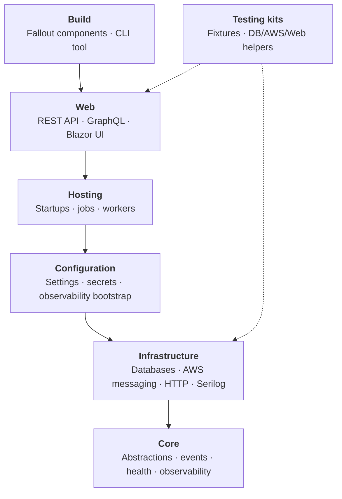

# Overview

The **Anarchy I/O Toolkit** is a set of reusable, self-contained NuGet packages for building .NET services: REST and GraphQL APIs, Blazor WebApps, AWS Lambda jobs and EC2 workers, with the persistence, messaging, observability and testing plumbing they share. It comes with a build system ([`Build.Fallout`](packages/Build.Fallout/README.md)) and a CLI tool ([`anarchy-toolkit`](packages/Build.Cli.Tool/README.md)) that set up new solutions the same way.

> **Provide the foundation. Never dictate the destination.** The toolkit ships plumbing, not a framework: your domain, your architecture decisions and your vendors stay yours.

## Three ways in

| You have | Start with | Page |
|---|---|---|
| An empty folder | The `anarchy-toolkit` CLI tool: a layered solution with its build, plus APIs, jobs and UIs. | [New solution with the CLI](getting-started/cli-tool.md) |
| An existing repository | The Fallout build components: compile, lint, test, layering, packaging and releases. | [Adding the Fallout build](getting-started/fallout.md) |
| An existing application | Individual packages, wired through their DI modules. | [Using the packages](getting-started/consuming-packages.md) |

## How the packages fit together

Every project under `src/` is one package, versioned and published on its own to [NuGet.org](https://www.nuget.org/profiles/anarchy-io). Its package ID, assembly name and root namespace are all `Anarchy.Toolkit.<project name>`, and its prefix is its **layer**. Dependencies only point down the layers, which `make check_layering` enforces:

The [Package Catalog](packages/README.md) lists every package by layer, and the [Layered Architecture guide](guides/architecture.md) explains the rule, including an interactive map of the project references.

## Design principles

- **Pluggable.** Packages with concrete services register them through an `IDependencyInjectionModule` or an `IServiceCollection` extension, so an application wires each one in a single call. Modules never assume a configuration section: options always come from the application.
- **Domain-free.** Generic code takes strings and generic parameters instead of domain enums. Domain code (repositories, clients, event payloads, message destinations, UI environments) stays in your applications.
- **Vendor-neutral.** Company-specific conventions plug in through extension points: an overridable `ObserverFactory` for logs and metrics, options and constructor parameters, and `ConfigureAppConfiguration` hooks for configuration sources.
- **Standalone.** Every dependency restores from nuget.org; test-only libraries such as AwesomeAssertions are confined to the `Testing.*` kits.

## Learn the conventions

The [guides](guides/README.md) describe how code is organized and written in the toolkit and in applications built with it: layering, async, enums, exceptions, endpoints, UIs, databases, observability, testing and builds. The [samples](samples/README.md) put them together in runnable applications.
