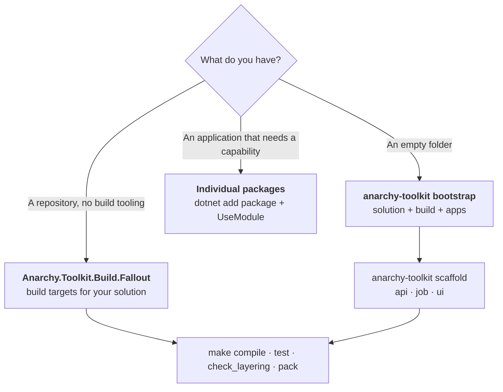

# Getting Started

Each pillar of the [platform](../README.md#the-three-pillars) can be adopted on its own. The fastest way to get the whole platform is through its **Build Ecosystem**: the **`anarchy-toolkit` CLI tool** creates a complete solution, and the **Fallout build components** it relies on can also be added to a repository you already have. Individual **Infrastructure** packages work on their own too.




| Path | Best for | Page |
|---|---|---|
| **CLI tool** | New services and monorepos: generates the layered solution, the Fallout build, the Makefile and scripts, and APIs, jobs or UIs on the toolkit's packages. | [New solution with the CLI](cli-tool.md) |
| **Fallout build** | Existing repositories: adds standard compile, lint, test, layering, dependency-map, packaging, release and Docker targets. | [Adding the Fallout build](fallout.md) |
| **Packages** | Existing applications: add persistence, messaging, observability, hosting or web plumbing one package at a time. | [Using the packages](consuming-packages.md) |

## Let your agent do it

Using a coding agent? Paste this line into it, from the folder or repository to adopt or migrate:

```text
Follow https://raw.githubusercontent.com/anarchy-io/anarchy-toolkit/main/agents/ADOPT.md to adopt Anarchy Toolkit in this repository, or migrate it to the latest version.
```

The agent works out which path fits, asks before anything destructive, can install the toolkit's [agent skills](cli-tool.md#agent-skills) and verifies the result with the build.

## Requirements

- The [.NET 10 SDK](https://dotnet.microsoft.com/download).
- Bash and Make, for the generated Makefile and scripts (macOS, Linux or WSL).
- Access to nuget.org, where the packages are published under the [`anarchy-io` profile](https://www.nuget.org/profiles/anarchy-io) (or a feed mirroring the `Anarchy.Toolkit.*` packages).

## See it working

The [samples](../samples/README.md) are complete applications built on the toolkit's defaults: a REST API, a Lambda job, an EC2 worker and a WebApp, with their tests.
