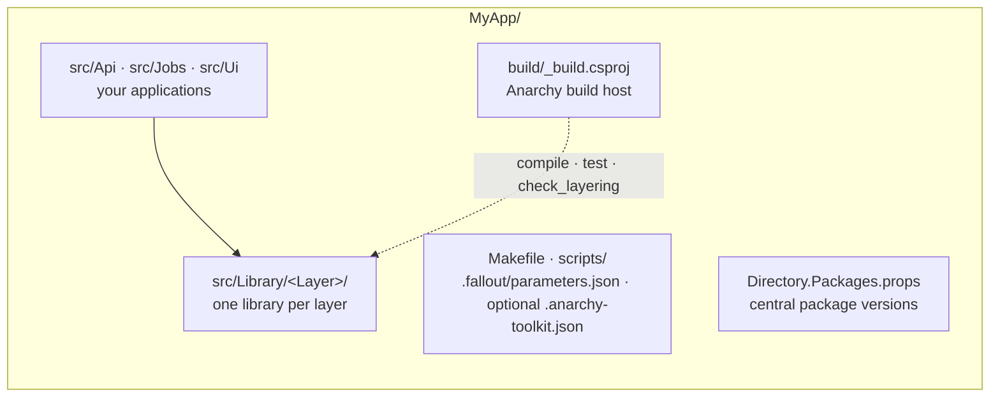

# New Solution with the CLI

The `anarchy-toolkit` .NET global tool is the entry point to the platform's **Build Ecosystem**: it creates solutions and adds applications to them. It is the quickest way to adopt all three pillars at once, with a layered solution (Architecture), applications wired to the toolkit packages (Infrastructure) and the Anarchy build already in place, powered by [Fallout Build](https://fallout.build/).

## Install

The tool is published to NuGet.org as [`Anarchy.Toolkit.Automation.Build.Cli`](https://www.nuget.org/packages/Anarchy.Toolkit.Automation.Build.Cli).

```bash
dotnet tool install --global Anarchy.Toolkit.Automation.Build.Cli
anarchy-toolkit --help
```

Update it later with `dotnet tool update --global Anarchy.Toolkit.Automation.Build.Cli`.

## Bootstrap a solution

Run the wizard and answer its questions:

```bash
anarchy-toolkit bootstrap
```

It asks for:

1. the solution name and output directory, which must be empty or not exist yet;
2. whether it will contain one application or several, before choosing a layering mode;
3. for one application, its kind and folder name (default: `App`); for several, which applications to start with and a name for each;
4. how projects are mapped to layers: by folder (the default) or by name prefix;
5. the layers, innermost first; a library project is created per layer, each referencing the one below it;
6. whether to install the agent skills (default: no; see [Agent skills](#agent-skills));
7. whether to save selected automation preferences (default: no).

It then shows the plan, including each web application's local ports, and writes nothing until you confirm. To skip the questions and create the baseline solution only:

```bash
anarchy-toolkit bootstrap MyApp --output ./MyApp [--with-skills] [--layout monorepo|single-app] [--application-folder MyApp] [layout options] [--save-preferences]
```

`--layout monorepo` keeps shared libraries under `src/`, grouped in `src/Library`; `--layout single-app` puts them
directly under `src` and maps one application folder to `Web` (API/UI) or `Hosting` (job). The folder defaults to `App`;
choose names such as `Api`, `Job`, `Cli` or the solution name with `--application-folder`. Use `--layering prefix` to
choose project-name prefixes without the wizard; use
`--save-preferences` only when the selected preference should be persisted. Otherwise bootstrap and scaffold use
operation arguments and defaults without creating or changing `.anarchy-toolkit.json`. Use the wizard when you need
custom layers. For saved defaults and editor commands, see [Automation Preferences](../guides/automation-preferences.md).

### What you get



| Kind | Built on | Starts with |
|---|---|---|
| API | [`Web`](../packages/Web/README.md) | A REST API with JWT authorization and a `/ping` endpoint. |
| Job | [`Hosting`](../packages/Hosting/README.md) | A job entry point (e.g., an AWS Lambda handler) and a service. |
| UI | [`Web.Ui`](../packages/Web.Ui/README.md) | A Blazor UI with cookie-session login and a home page. |

APIs and UIs belong to the `Web` layer and jobs to the `Hosting` layer. Package versions are managed centrally in `Directory.Packages.props`, and existing files are never overwritten.

## Build and run

```bash
cd MyApp
make install        # set up the local .NET environment, restore and compile
make check_layering # verify that dependencies only point down the layers
make test           # run the tests
make help           # list every target
```

Review each application's settings (auth service URLs, client IDs and scopes) before running it, and use `make appsettings` to generate the untracked `appsettings.Development.json` files.

## Add applications later

From anywhere inside the solution:

```bash
anarchy-toolkit scaffold          # guided
anarchy-toolkit scaffold api Users
anarchy-toolkit scaffold job ClientSync
anarchy-toolkit scaffold ui UserAdmin
```

The tool places each application from explicit arguments, optional saved preferences and then the standard in-code folder baseline; a preferences file is not required and the tool does not infer a layout. Pass `--save-preferences` to persist selected choices. It adds the application to the solution and references the toolkit package it needs, following the solution's central package management.

## Agent skills

The toolkit ships agent skills that teach coding agents (Claude Code, OpenCode, Codex and others that read `.agents/skills`) how to bootstrap, scaffold, build, test, run, release and maintain the solution: `anarchy` is the entry point, `anarchy-conventions` holds the recommended coding conventions, and `anarchy-develop`, `anarchy-environment`, `anarchy-release` and `anarchy-maintenance` cover each area. They are opt-in; add them to an existing solution with:

```bash
anarchy-toolkit skills install   # or: make install_skills
```

Mark your own make targets with `#@ <skill>`, then `make skills_sync` creates their skills from a template and `make skills_validate` checks that the skills are complete and up to date (see [Agent skills](../packages/Automation.Build/README.md#agent-skills)). To let an agent adopt the toolkit for you, see [Let your agent do it](README.md#let-your-agent-do-it).

## Next steps

- Learn what the generated build can do in [Adding Anarchy automation](automation.md) and the [Anarchy Automation Builds guide](../guides/automation-builds.md).
- Follow the [Layered Architecture guide](../guides/architecture.md) as the solution grows.
- The full reference, including the layering options, is the [`Automation.Build.Cli` package page](../packages/Automation.Build.Cli/README.md).
