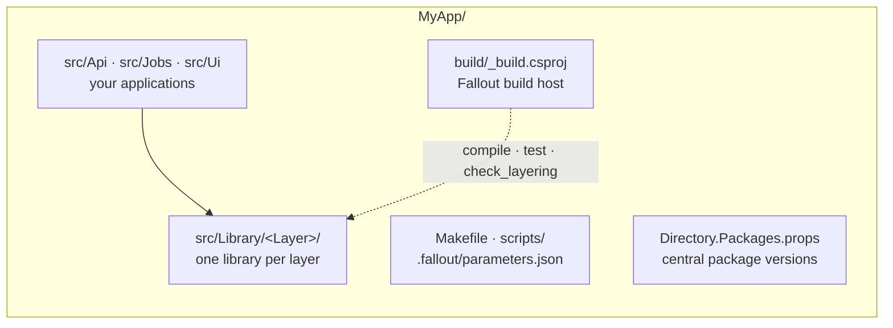

# New Solution with the CLI

The `anarchy-toolkit` .NET global tool is the entry point to the platform's **Build Ecosystem**: it creates solutions and adds applications to them. It is the quickest way to adopt all three pillars at once, with a layered solution (Architecture), applications wired to the toolkit packages (Infrastructure) and the Fallout build already in place.

## Install

The tool is published to NuGet.org as [`Anarchy.Toolkit.Build.Cli.Tool`](https://www.nuget.org/packages/Anarchy.Toolkit.Build.Cli.Tool).

```bash
dotnet tool install --global Anarchy.Toolkit.Build.Cli.Tool
anarchy-toolkit --help
```

Update it later with `dotnet tool update --global Anarchy.Toolkit.Build.Cli.Tool`.

## Bootstrap a solution

Run the wizard and answer its questions:

```bash
anarchy-toolkit bootstrap
```

It asks for:

1. the solution name;
2. the output directory, which must be empty or not exist yet;
3. how projects are mapped to layers: by folder (the default) or by name prefix;
4. the layers, innermost first (default: `Core, Infrastructure, Configuration, Hosting, Web`); a library project is created per layer, each referencing the one below it;
5. which applications to start with (APIs, jobs and UIs), and a name for each.

It then shows the plan, including each web application's local ports, and writes nothing until you confirm. To skip the questions and create the baseline solution only:

```bash
anarchy-toolkit bootstrap MyApp --output ./MyApp
```

### What you get



| Kind | Built on | Starts with |
|---|---|---|
| API | [`Web`](../packages/Web/README.md) | A REST API with JWT authorization and a `/ping` endpoint. |
| Job | [`Hosting`](../packages/Hosting/README.md) | A job entry point (e.g., an AWS Lambda handler) and a service. |
| UI | [`Web.Ui`](../packages/Web.Ui/README.md) | A Blazor UI with cookie-session login and a home page. |

APIs and UIs belong to the `Web` layer and jobs to the `Hosting` layer. Package versions are managed centrally in `Directory.Packages.props`, and existing files are never overwritten.

## Build and run

```bash
cd MyApp
make install        # set up the local .NET environment, restore and compile
make check_layering # verify that dependencies only point down the layers
make test           # run the tests
make help           # list every target
```

Review each application's settings (auth service URLs, client IDs and scopes) before running it, and use `make appsettings` to generate the untracked `appsettings.Development.json` files.

## Add applications later

From anywhere inside the solution:

```bash
anarchy-toolkit scaffold          # guided
anarchy-toolkit scaffold api Users
anarchy-toolkit scaffold job ClientSync
anarchy-toolkit scaffold ui UserAdmin
```

The tool places each application according to the solution's layering settings, adds it to the solution and references the toolkit package it needs, following the solution's central package management.

## Next steps

- Learn what the generated build can do in [Adding the Fallout build](fallout.md) and the [Fallout Builds guide](../guides/fallout-builds.md).
- Follow the [Layered Architecture guide](../guides/architecture.md) as the solution grows.
- The full reference, including the layering options, is the [`Build.Cli.Tool` package page](../packages/Build.Cli.Tool/README.md).
