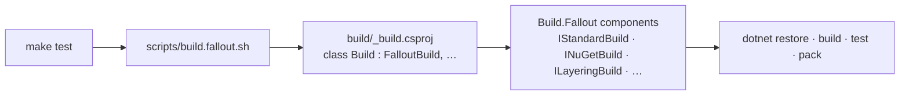

# Adding the Fallout Build

[`Anarchy.Toolkit.Build.Fallout`](../packages/Build.Fallout/README.md) packages a complete [Fallout](https://fallout.build/) build as reusable components: implement the interfaces you need on your build class and you get their targets, plus a self-documenting Makefile on top. It is what the [CLI tool](cli-tool.md) generates, and it works just as well in a repository you already have.



## Add a build host

The components are published to NuGet.org as [`Anarchy.Toolkit.Build.Fallout`](https://www.nuget.org/packages/Anarchy.Toolkit.Build.Fallout).

With the .NET 10 SDK, Bash and Make installed, from the repository root:

```bash
mkdir -p build .fallout
dotnet new console --framework net10.0 --name _build --output build
dotnet add build/_build.csproj package Anarchy.Toolkit.Build.Fallout
printf '{ "Solution": "MyApp.sln" }\n' > .fallout/parameters.json
```

## Pick your components

Replace `build/Program.cs` with a build class implementing the components that suit your repository:

```csharp
using Anarchy.Toolkit.Build.Fallout.Component;
using Anarchy.Toolkit.Build.Fallout.Core.Entity.Build;
using Anarchy.Toolkit.Build.Fallout.Infrastructure.Extension;
using Fallout.Common;

class Build : FalloutBuild, IStandardBuild, ILayeringBuild, IDependencyMapBuild,
              IDependencyUpgradeBuild, IGitHooksBuild, IBoilerplateBuild
{
    public IReadOnlyCollection<Artifact> Artifacts => [];
    public static int Main() => Execute<Build>(x => x.As<IDefaultBuild>().Clean);
}
```

| Component | Gives you |
|---|---|
| `IStandardBuild` | `Restore`, `Compile`, `Lint`/`LintFix`, `TestUnit`/`TestIntegration`/`TestEndToEnd`/`TestAll`, `RunApp(s)`, `GenerateAppSettings`, `PullRequest`. |
| `ILayeringBuild` | `CheckLayering`: fails when a project depends on a higher layer. |
| `IDependencyMapBuild` | `GenerateDependencyMap`: an HTML map of project references by layer. |
| `INuGetBuild` | `ListPackages`, `Pack` and dependency-ordered `Publish`, plus release versioning and notes. |
| `IDockerBuild`, `IContainerBuild` | A local Docker Compose environment, and container image builds and pushes. |
| `IDependencyUpgradeBuild`, `IGitHooksBuild` | Dependency upgrades and Git hook management. |
| `IBoilerplateBuild` | `SetupBoilerplate`: installs the Makefile, scripts and configuration files. |

The [Fallout Builds guide](../guides/fallout-builds.md) describes every component, its targets and parameters.

## Install the Makefile and scripts

`SetupBoilerplate` installs the packaged Makefile, scripts and configuration without overwriting existing files. Choose what to install with `--boilerplate-items` and `--boilerplate-exclude`:

```bash
dotnet run --project build/_build.csproj -- SetupBoilerplate \
  --boilerplate-items Makefile,scripts,.editorconfig \
  --append-existing
```

In an empty folder, omit `--boilerplate-items` and pass `--boilerplate-solution-name MyApp` to also create the solution and a starter `src/Core` project. See [choosing what to install](../packages/Build.Fallout/README.md#choosing-what-to-install) for every item.

## Use it

```bash
make help            # every target, with its parameters
make install         # set up the local .NET environment, restore and compile
make lint test       # what a pull request runs
make check_layering
make fallout TARGET=Pack
```

For CI, `make pull_request` runs linting, the layering check (when implemented) and all tests.

## Next steps

- Organize projects by layer with the [Layered Architecture guide](../guides/architecture.md).
- Set up automatic NuGet releases with [Fallout Builds → NuGet packages](../guides/fallout-builds.md#nuget-packages).
- Add a local database or broker with `IDockerBuild`, described in the [package page](../packages/Build.Fallout/README.md#local-containers).
