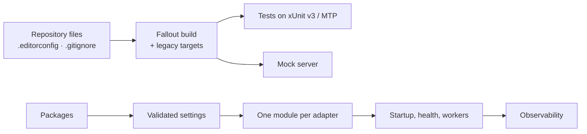

# Adopting an Existing Solution

How to move a running service onto the platform **in place, while it keeps shipping**: the plumbing changes, the business logic and the contract don't. The order and the techniques come from a real migration plan for a production API with 17 test projects, a [MockServer](https://www.mock-server.com/) container and a pipeline whose make targets could not change.

> Using a coding agent? The `anarchy-adopt` skill and [`agents/ADOPT.md`](https://raw.githubusercontent.com/anarchy-io/anarchy-toolkit/main/agents/ADOPT.md) follow this guide step by step.
{: .notice--info}

## Ground rules

| Rule | Why |
|---|---|
| **One concern per pull request.** Mechanical changes (moves, renames, formatting) never share a commit with behaviour changes. | Reviewers skim the mechanical diff and focus on the rest. |
| **Every pull request deploys on its own.** | Nothing waits on the next step to work. |
| **The pipeline contract holds.** [Make](https://www.gnu.org/software/make/) targets the pipeline calls keep their names and meaning. | Many pipelines aren't versioned with the code. |
| **The contract is pinned by tests.** Routes, bodies, status codes, health paths, metric names and log properties stay the same; snapshots and end-to-end tests prove it. | The migration is invisible to consumers. |
| **Map before you rename.** Prefer parameters (`SourceRoot`, `TestKindAliases`, `LayeringByFolder`) over moving files. | Fewer, smaller diffs. |

## The order



The build track (top) and the runtime track (bottom) are independent: two people can work on them in parallel.

### Repository files

Install the toolkit's `.editorconfig` and `.gitignore` into managed blocks, leaving your own entries outside them:

```bash
anarchy-toolkit boilerplate diff .gitignore .editorconfig
```

Then run `make lint_fix` in a separate, formatting-only commit. Leave [`global.json`](https://learn.microsoft.com/dotnet/core/tools/global-json) alone until the tests have moved (step 3).

### The Fallout build, next to what you have

Add `build/_build.csproj` with the components that fit (start with `IStandardBuild` and `IBoilerplateBuild`; skip `ILayeringBuild` until the layout is layered), then install the Makefile and scripts without overwriting anything:

```bash
dotnet run --project build/_build.csproj -- SetupBoilerplate --boilerplate-items Makefile,scripts --append-existing --boilerplate-dry-run
```

Move the targets your pipeline calls (`install`, `build_release`, `run_smoke_test`, ...) to your own `.mk` files (for example `scripts/make/project/*.mk`), included by your Makefile after the toolkit's and listed in `MAKE_EXTRA_TARGETS`, so `make help` shows the old and the new ones together. If your build also deploys, move it unchanged to a separate `release/` host first; the toolkit's build doesn't deploy ([ADR 0006](../decisions/0006-fallout-build.md)).

Map your test projects instead of renaming them: `"TestKindAliases": ["EndToEnd=Acceptance"]`. See [Testing: opting out](../conventions/testing.md#opting-out-or-adapting).

### Tests on xUnit v3

One group of projects per pull request, with the same test counts before and after. [Fallout](https://fallout.build/) runs [VSTest](https://github.com/microsoft/vstest) and MTP projects side by side, so the solution can be mixed for as long as needed; set the MTP runner in `global.json` only with the last group. See the [recipe](migration-recipes.md#xunit-v2-and-vstest-to-xunit-v3-and-mtp).

### Mock server

Replace a MockServer container with the toolkit's mock server: expectation files move unchanged, the unmatched-request check moves into the tests. See the [recipe](migration-recipes.md#mockserver-container-to-the-toolkit-mock-server).

### Packages and validated settings

Add the runtime packages you'll use, and nothing else yet. Then add an `AppSettings` with the existing section names, registered with `ModuleAppSettingsBase` next to today's binding: nothing reads it, it only fails the boot when a section is missing. Add validation attributes only where every environment already satisfies them.

### One module per adapter

Wrap each existing `Add*` extension in a module, smallest first, and call it from today's `Startup` with `services.UseModule(...)`. Each module gets a test that resolves its graph in isolation. See the [recipe](migration-recipes.md#add-extensions-to-modules).

### Startup, health and background work

Move the host to the toolkit's startup base, keeping every middleware in the same order. Then health checks to `ServiceHealthReportBase` (compare paths and bodies first: load balancers depend on them) and hosted services to `MonitoredWorkerBase`.

### Observability last

Run your current monitoring facade and `Observer` side by side, built on the same [Serilog](https://serilog.net/) logger and metrics client, then move call sites over in their own changes. Compare a log event and the metric names before and after on a test environment: dashboards and monitors read them.

## What can stay as it is

Everything the toolkit doesn't need: your business logic, your project names (mapped by parameters), nullable settings, your release and deployment, your exception middleware, your snapshot library. The [conventions](../conventions/README.md) are recommendations; adopt them later or never.

## Common surprises

See [Pitfalls](pitfalls.md): the MTP runner in `global.json`, [Moq](https://github.com/devlooped/moq) versions, transitive version bumps, ports and health paths.
