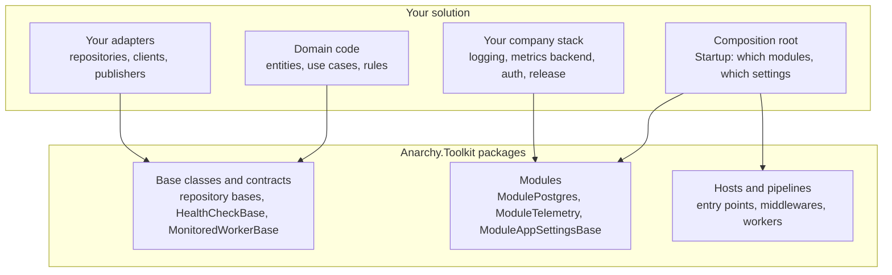

# How the Platform Fits Together

A map of the platform before you touch it: what each piece is for, how a request or a job travels through the toolkit's types, and which parts stay yours. Read this first; the other guides assume it.

## Three pillars, adopted separately

| Pillar | What you get | You can use it without the others? |
|---|---|---|
| **Architecture** | A layer chain (`Core < Infrastructure < Configuration < Hosting < Web`, with `Automation` for build tooling on top), a folder per responsibility, DI modules, and a build check that keeps them honest. | Yes: it is a way of organizing code, plus `ILayeringBuild`. |
| **Infrastructure** | NuGet packages for the plumbing: settings, telemetry, persistence, messaging, HTTP, health, workers, web and UI pipelines, test kits, a mock server. | Yes: `dotnet add package` one at a time. |
| **Build Ecosystem** | Anarchy automation components powered by [Fallout Build](https://fallout.build/), a distributed Makefile and scripts, the `anarchy-toolkit` CLI and agent skills. | Yes: the build runs on any .NET solution. |

Most teams start with one pillar and add the others when they see the benefit. The [adoption advisor](../getting-started/advisor.md) suggests an order for your situation.

## What is yours, what is the toolkit's



The toolkit is [domain-free](../decisions/README.md#values): it never knows your entities, section names, upstream URLs or vendors. You subclass its bases, pass it your options, and plug your company specifics into its extension points.

## The life of a request

1. **Entry point.** `Program` calls the toolkit's web host builder with your `Startup` (an `IWebAppStartup`).
2. **Composition.** `Startup` applies modules with `services.UseModule(...)`: `ModuleLibConfiguration` for settings, telemetry and secrets, then the infrastructure modules (`ModulePostgres`, `ModuleSnsMessageBroker`, ...) and your own. Settings are validated before the host starts.
3. **Pipeline.** The toolkit's middlewares add the correlation id, request logging and exception mapping; your controllers or endpoints run after them.
4. **Your code.** A controller maps the input DTO, calls a Core service, which uses a repository contract implemented by an Infrastructure adapter built on a toolkit base (unit of work, retry policy, health report).
5. **Telemetry.** Every layer logs and measures through the same `AppTelemetry`, written to the standard Microsoft logging and .NET metrics pipelines: the providers and exporters you registered decide where it all goes, and the correlation ID travels with the request.

## The life of a job or a worker

- **Jobs** (for example [AWS Lambda](https://aws.amazon.com/lambda/)) use `JobEntryPointBase<TStartup>` and a `JobStartupBase`: the same modules and settings, without the web pipeline.
- **Workers** derive `MonitoredWorkerBase` and implement one iteration; the toolkit runs the loop, records start, stop, failures and a heartbeat metric, and stops on cancellation. `AddServiceHealthCheckWorker` serves health endpoints for processes without a web host.

## The development loop

```text
make install              set up the SDK, restore and compile
make test_unit            fast tests, no I/O
make start                Docker services, if any (databases, brokers)
make test_integration     adapters against real or mocked dependencies
make test_end_to_end_mocked   whole applications against the mock server
make check_layering       dependencies only point down
make pull_request         what the PR pipeline runs
```

The same targets exist in every solution on the platform, so moving between repositories, or handing work to a coding agent with the toolkit's [agent skills](../getting-started/cli-tool.md#agent-skills), needs no new instructions.

## Where to go next

- Starting from nothing: [Your first solution](greenfield-solution.md).
- Bringing an existing repository: [Adopting an existing solution](adopting-existing-solution.md).
- Wiring your company's logging, auth or release: [Bringing your company stack](bringing-your-company-stack.md).
