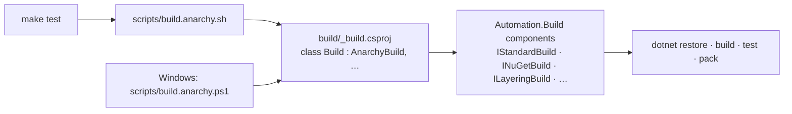

# Adding Anarchy Automation

Part of the platform's **Build Ecosystem**, [`Anarchy.Toolkit.Automation.Build`](../packages/Automation.Build/README.md) provides reusable build components powered by [Fallout Build](https://fallout.build/): implement the interfaces you need on your build class and you get their targets, plus a self-documenting Makefile on top. It is what the [CLI tool](cli-tool.md) generates, and it works just as well in a repository you already have.



## Add a build host

The components are published to NuGet.org as [`Anarchy.Toolkit.Automation.Build`](https://www.nuget.org/packages/Anarchy.Toolkit.Automation.Build).

With the .NET 10 SDK, Bash and Make installed, from the repository root:

```bash
mkdir -p build .fallout
dotnet new console --framework net10.0 --name _build --output build
dotnet add build/_build.csproj package Anarchy.Toolkit.Automation.Build
printf '{ "Solution": "MyApp.sln" }\n' > .fallout/parameters.json
```

`.fallout/` is Fallout's folder (its root marker, parameters and generated schema). No toolkit preferences file is
required: layering defaults to folder mode over `Core < Infrastructure < Bootstrap < Runtime < Apps`, with libraries under
`src/Library/<Layer>` and applications under `src/Apps/Apis`, `src/Apps/Jobs` and `src/Apps/Ui`. For a single
application whose layer projects sit directly under `src/`, pass the layout arguments to operations or explicitly
save `{ "layering": { "libraryRoot": "src", "applicationFolders": { "src/App": "Apps" } } }` in
`.anarchy-toolkit.json`. See [Layering](../conventions/layering.md#choose-one-project-layering-mode) for monorepos and
the name-prefix alternative, and [Automation Preferences](../guides/automation-preferences.md) for all settings and
editing commands.

## Pick your components

Replace `build/Program.cs` with a build class (e.g. `build/Build.cs`) implementing the components that suit your repository:

```csharp
using Anarchy.Toolkit.Automation.Build.Component;
using Anarchy.Toolkit.Automation.Build.Core.Entity.Build;
using Anarchy.Toolkit.Automation.Build.Extensions.Fallout.Common;
class Build : AnarchyBuild, IStandardBuild, ILayeringBuild, IDependencyMapBuild,
              IDependencyUpgradeBuild, IGitHooksBuild, IBoilerplateBuild, IAgentSkillsBuild
{
    public IReadOnlyCollection<Artifact> Artifacts => [];
    public static int Main() => Execute<Build>(x => x.As<IDefaultBuild>().Clean);
}
```

| Component | Gives you |
|---|---|
| `IStandardBuild` | `Restore`, `Compile`, `Lint`/`LintFix`, `TestUnit`/`TestIntegration`/`TestEndToEnd`/`TestAll`, `RunApp(s)`, `GenerateAppSettings`, `PullRequest`. |
| `ILayeringBuild` | `CheckLayering`: fails when a project depends on a higher layer. |
| `IDependencyMapBuild` | `GenerateDependencyMap`: an HTML map of project references by layer. |
| `INuGetBuild` | `ListPackages`, `Pack` and dependency-ordered `Publish`, plus release versioning and notes. |
| `IDockerBuild`, `IContainerBuild` | A local Docker Compose environment, and container image builds and pushes. |
| `IDependencyUpgradeBuild`, `IGitHooksBuild` | Dependency upgrades and Git hook management. |
| `IBoilerplateBuild` | `SetupBoilerplate`: installs the Makefile, scripts, configuration files and, on request, the agent skills. |
| `IAgentSkillsBuild` | `ValidateAgentSkills` and `SyncAgentSkills`: keeps the agent skills in step with the Makefiles. |

The [Anarchy Automation Builds guide](../guides/automation-builds.md) describes every component, its targets and parameters.

## Install the Makefile and scripts

`SetupBoilerplate` installs the packaged Makefile, scripts and configuration without overwriting existing files. Choose what to install with `--boilerplate-items` and `--boilerplate-exclude`:

```bash
dotnet run --project build/_build.csproj -- SetupBoilerplate \
  --boilerplate-items Makefile,scripts,.editorconfig \
  --append-existing
```

In an empty folder, omit `--boilerplate-items` and pass `--boilerplate-solution-name MyApp` to also create the solution and a starter `src/Core` project. See [choosing what to install](../packages/Automation.Build/README.md#choosing-what-to-install) for every item.

## Use it

```bash
make help            # every target, with its parameters
make install         # set up the local .NET environment, restore and compile
make lint test       # what a pull request runs
make check_layering
make anarchy TARGET=Pack
```

For CI, `make pull_request` runs linting, the layering check (when implemented) and all tests. To run several targets
yourself, chain them in one call (`dotnet run --project build/_build.csproj -- Lint TestUnit`) rather than one call per
target, so the build compiles once.

## Agent skills

To let coding agents drive the build, install the toolkit's skills into `.agents/skills` (they are never installed by default). Mark your own make targets with `#@ <skill>` to give them skills too:

```bash
make install_skills   # anarchy, anarchy-develop, anarchy-environment, anarchy-release, anarchy-maintenance
make skills_sync      # create skills for your #@ targets and refresh every skill's commands table
make skills_validate  # fails when a skill is missing, unfinished or out of date; run it in CI
```

See [Agent skills](../packages/Automation.Build/README.md#agent-skills) for the markers and the skill template.

## Next steps

- Already have a NUKE or Cake build? See [Coming from another build tool](../guides/automation-builds.md#coming-from-another-build-tool).
- Organize projects by layer with the [Layered Architecture guide](../guides/architecture.md).
- Set up automatic NuGet releases with [Anarchy Automation Builds → NuGet packages](../guides/automation-builds.md#nuget-packages).
- Add a local database or broker with `IDockerBuild`, described in the [package page](../packages/Automation.Build/README.md#local-containers).
