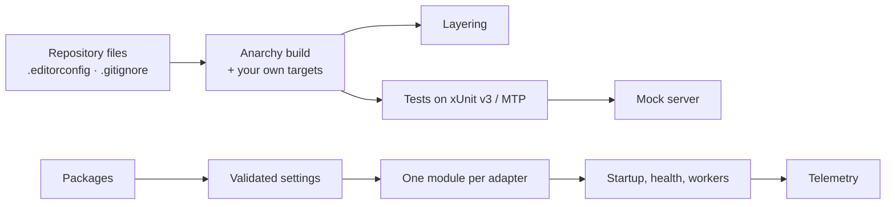

# Adopting an Existing Solution

How to add the platform to a repository that already runs a service, **in place and in small steps**, so it keeps shipping while it gains the toolkit's build, packages and conventions. The order and the techniques come from a real onboarding plan for a production API with 17 test projects and a pipeline whose make targets could not change.

> Using a coding agent? The `anarchy-adopt` skill and [`agents/ADOPT.md`](https://raw.githubusercontent.com/anarchy-io/anarchy-toolkit/main/agents/ADOPT.md) follow this guide step by step.
{: .notice--info}

## Ground rules

| Rule | Why |
|---|---|
| **One concern per pull request.** Mechanical changes (moves, renames, formatting) never share a commit with behaviour changes. | Reviewers skim the mechanical diff and focus on the rest. |
| **Every pull request deploys on its own.** | Nothing waits on the next step to work. |
| **The pipeline contract holds.** [Make](https://www.gnu.org/software/make/) targets the pipeline calls keep their names and meaning. | Many pipelines aren't versioned with the code. |
| **Your service's contract holds.** Routes, bodies, status codes, health paths, metric names and log properties stay as they are; snapshots and end-to-end tests prove it. | Adopting the toolkit is invisible to consumers. |
| **Describe your layout to the build.** Point it at your folders with configuration (`SourceRoot`, `TestsRoot`, `TestKindAliases`, and optional layering arguments or `.anarchy-toolkit.json` overrides) instead of relocating files. | Fewer, smaller diffs. |

## The order



The build track (top) and the runtime track (bottom) are independent: two people can work on them in parallel. The [onboarding recipes](onboarding-recipes.md) give the steps and the "done when" check of each piece.

### Repository files

Install the toolkit's `.editorconfig` and `.gitignore` into managed blocks, leaving your own entries outside them:

```bash
anarchy-toolkit boilerplate diff .gitignore .editorconfig
```

Then run `make lint_fix` in a separate, formatting-only commit. Leave [`global.json`](https://learn.microsoft.com/dotnet/core/tools/global-json) alone until the first xUnit v3 test project exists.

### Anarchy automation, next to your pipeline

Add `build/_build.csproj` with the components that fit (start with `IStandardBuild` and `IBoilerplateBuild`; add `ILayeringBuild` once the layering is recorded), then install the Makefile and scripts without overwriting anything:

```bash
dotnet run --project build/_build.csproj -- SetupBoilerplate --boilerplate-items Makefile,scripts --append-existing --boilerplate-dry-run
```

Keep the targets your pipeline calls (`install`, `build_release`, `run_smoke_test`, ...) in your own `.mk` files (for example `scripts/make/project/*.mk`), included by your Makefile after the toolkit's and listed in `MAKE_EXTRA_TARGETS`, so `make help` lists yours and the toolkit's together. If your build also deploys, keep that in a separate `release/` host: the toolkit's build doesn't deploy ([ADR 0011](../decisions/0011-fallout-build.md)).

If your code or tests are not under `src` and `tests`, say where they are with `SourceRoot` and `TestsRoot`; if your test projects have their own names, declare them with `"TestKindAliases": ["EndToEnd=Acceptance"]`. See [Testing: opting out](../conventions/testing.md#opting-out-or-adapting). Coming from NUKE or Cake? See [Coming from another build tool](automation-builds.md#coming-from-another-build-tool).

### Layering

`ILayeringBuild` uses a folder-mode baseline (`src/Library`, standard application folders and layers) when no preference is saved or passed. Adding it does not require a configuration file. Choose **one** mode for the whole solution: **folder** (recommended) when projects already sit, or can sit, in layer folders such as `src/Library/Core`; **prefix** when they are named after their layer (`Library.Core`, `Apps.Api.Orders`, or `Core.*`, `Infrastructure.*` as the toolkit's own are). The default layers are `Core < Infrastructure < Bootstrap < Runtime < Apps`; your build stays in `build/`, outside them. Provide the choice as explicit operation arguments or save selected overrides in `.anarchy-toolkit.json`. Map application folders (`src/Apps/Apis`, `src/Apps/Jobs`, or wherever yours are) to their layer (`Apps` by default), and leave the check out of the pull-request gate until it passes locally. The tooling does not infer a mode. See [Layering](../conventions/layering.md), [Code Organization](../conventions/code-organization.md) and the [settings-file guide](automation-preferences.md) for what belongs in `.fallout/parameters.json` versus `.anarchy-toolkit.json`.

### Tests

Test projects use xUnit v3 on Microsoft.Testing.Platform, which is what the `Testing.*` kits and the `make test_*` targets expect; see the [recipe](onboarding-recipes.md#add-an-xunit-v3-test-project). Name them by kind, or declare their names ([recipe](onboarding-recipes.md#name-test-projects-by-kind)).

### Mock server

If your tests call HTTP upstreams, add the toolkit's mock server: expectation files in MockServer's JSON format, and a check that fails the run on unmocked calls. See the [recipe](onboarding-recipes.md#add-the-mock-server).

### Packages and validated settings

Add the runtime packages you'll use, and nothing else yet. AWS integrations (`Bootstrap.Aws`, `Runtime.Aws`, `Runtime.Web.Aws`), Swagger (`Runtime.Web.Swagger`) and MSAL clients (`Infrastructure.Http.Msal`) are separate opt-in packages. Then add an `AppSettings` with your section names and `ModuleAppSettingsBase`; the boot fails when a section is missing. Add validation attributes only where every environment already satisfies them. See the [recipe](onboarding-recipes.md#add-validated-settings).

### One module per adapter

Give each adapter you register a module, smallest first, applied from the `Startup` with `services.UseModule(...)`, each with a test that resolves its graph in isolation. See the [recipe](onboarding-recipes.md#write-a-module).

### Startup, health and background work

Build hosts on the toolkit's startup base, keeping every middleware in the same order, then add [health checks](onboarding-recipes.md#add-a-health-check) and [workers](onboarding-recipes.md#add-a-worker). Keep the health paths and bodies load balancers already depend on.

### Telemetry last

Register `AppTelemetry` (`ModuleLibConfiguration` does it for you) on the logging providers and metrics exporter the application uses: [Serilog](https://serilog.net/) through `AddSerilogTelemetry`, or an OpenTelemetry OTLP exporter for the toolkit's meter. Toolkit packages then write to that pipeline. Check one log line and the metric names on a test environment: dashboards and monitors read them. See [Observability](observability.md) and [Bringing your company stack](bringing-your-company-stack.md).

### Pull-request gate

Once the build and its checks are ready, run `make pull_request` locally and in CI. Remove `ILayeringBuild` from `build/Build.cs` to opt out; to adapt your layout, use [layering preferences](automation-preferences.md) or follow the [layering convention's opt-out guidance](../conventions/layering.md#opting-out-or-adapting).

## What can stay as it is

Everything the toolkit doesn't need: your business logic, your project names (declared in configuration), nullable settings, your release and deployment, your exception middleware, your snapshot library. The [conventions](../conventions/README.md) are recommendations; adopt them later or never.

## Common surprises

See [Pitfalls](pitfalls.md): the MTP runner in `global.json`, [Moq](https://github.com/devlooped/moq) versions, transitive version bumps, ports and health paths.
